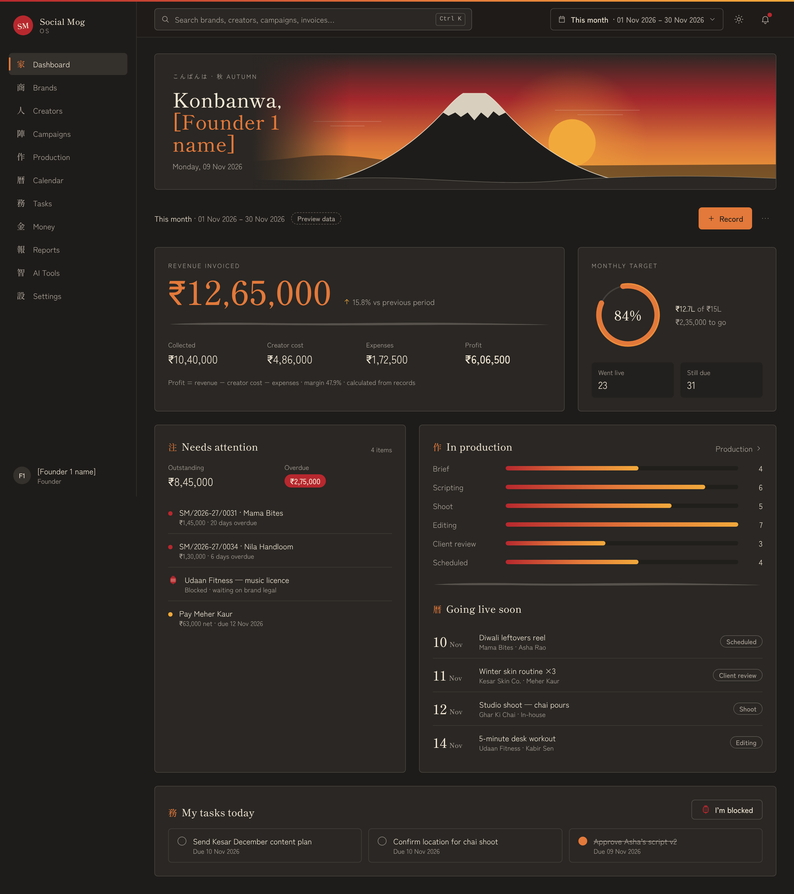

# Social Mog OS

Internal database and management site for **Social Mog**, an influencer production and campaign agency in India.
It keeps brands, creators, campaigns, production, tasks and money in one place, and calculates every total from the records.

**Status:** project set up, the full database schema is in place, and there is a design preview of the dashboard, the brands list and a brand detail page (using fictional preview data).
None of the numbered features are built yet.



## Rules every feature follows

| Area | Rule |
|---|---|
| Stack | Supabase (Postgres, Auth, Storage, Edge Functions) + React/Vite/TypeScript/Tailwind |
| Tables | Real tables with foreign keys, not JSON blobs. Every table has `id uuid`, `created_at`, `updated_at` and `created_by`. Business records have `is_archived`/`archived_at` and are never hard-deleted. |
| Security | RLS is on for every table (the migration fails if one is missing). Only active team members can read or write. Bank/PAN details, capital, API keys and backups are restricted to founders and admins. |
| Activity | A trigger on every business table writes each create, update, status change, archive, restore and delete to `activity_log`, with who, which record, and old/new values. |
| Secrets | Only the public anon key is in the frontend. Service-role and AI keys live in Edge Function secrets. |
| Money | `numeric(14,2)`, INR. Shown as ₹1,00,000. Totals, balances, profit and outstanding amounts come from views and are never typed in. |
| Dates | DD MMM YYYY, Asia/Kolkata. The financial year runs 1 Apr – 31 Mar. Weeks run Monday–Sunday. |
| Lists | Search, filters, sort and CSV export on every list page |
| Records | Every record has a detail page with its linked records and activity history |

## Database (`supabase/migrations`)

```
profiles ─┬─ user_preferences            org_settings (1 row) · document_sequences
          └─ (created_by on every table)  import_batches ─ import_rows

brands ─┬─ brand_contacts
        ├─ brand_tags ─ tags ─ creator_tags ─┐
        ├─ retainers ─ retainer_scope_items  │
        └─ campaigns ─┬─ campaign_creators ──┤── creators ─┬─ creator_platforms ─ creator_metric_snapshots
                      │                      │             ├─ creator_rate_cards
                      │                      │             └─ creator_payment_details (founders only)
                      └─ deliverables ───────┘  (brand required; campaign/retainer optional)
                           ├─ scripts ─ ai_requests
                           ├─ deliverable_reviews · deliverable_metrics
                           └─ shoot_deliverables ─ shoots ─ shoot_crew (team / vendor / creator)
calendar_events            vendors (freelancers, studios, software)

money_accounts ─┬─ receipts ─ receipt_allocations ─ invoices ─ invoice_items
                ├─ expenses ─ expense_categories
                ├─ creator_payouts ─ creator_payout_items
                ├─ capital_entries (opening balance, founder in/out, loans)
                └─ account_transfers
targets

tasks · comments · files · notifications · automation_rules · reminders
ai_prompt_templates · ai_requests · api_clients · api_request_log · webhook_subscriptions
backups · saved_views · activity_log
```

**Calculated views:** `invoice_totals` (GST, paid, outstanding, overdue status), `creator_payout_totals` (gross, TDS, net), `money_ledger`, `account_balances`, `campaign_financials` (profit, margin), `brand_financials`.
**Functions:** `period_summary(period)`, `period_bounds()`, `fy_start()`, `fy_label()`.
The periods are `this_week`, `last_week`, `this_month`, `last_month`, `this_quarter`, `last_quarter`, `this_fy`, `last_fy` and `custom`.

## Running it

```bash
npm install
cp .env.example .env.local   # add your Supabase URL + anon key
npm run dev                  # http://localhost:5173  (/login shows the sign-in design)
npm test                     # unit tests: ₹ format, IST dates, FY periods, CSV
npm run check:contrast       # WCAG AA check of every colour pair
npm run test:db              # migrations + smoke test on a local Postgres
```

Apply the schema to Supabase with `supabase db push`.
Then, in **Auth settings**, turn off open sign-ups (invite only).
The first account to sign up becomes an active founder. Every later account starts with no access until a founder turns it on.

## Design system

The colour tokens are in `tailwind.config.js` and `src/styles/index.css`.
The original SVG artwork is in `src/components/art`: Fuji with a sky that follows IST time, the seasonal effects, ensō, hanko seals, brush dividers, the andon lantern, and the seigaiha, asanoha and torii patterns.
Screenshots are in `docs/preview`.
