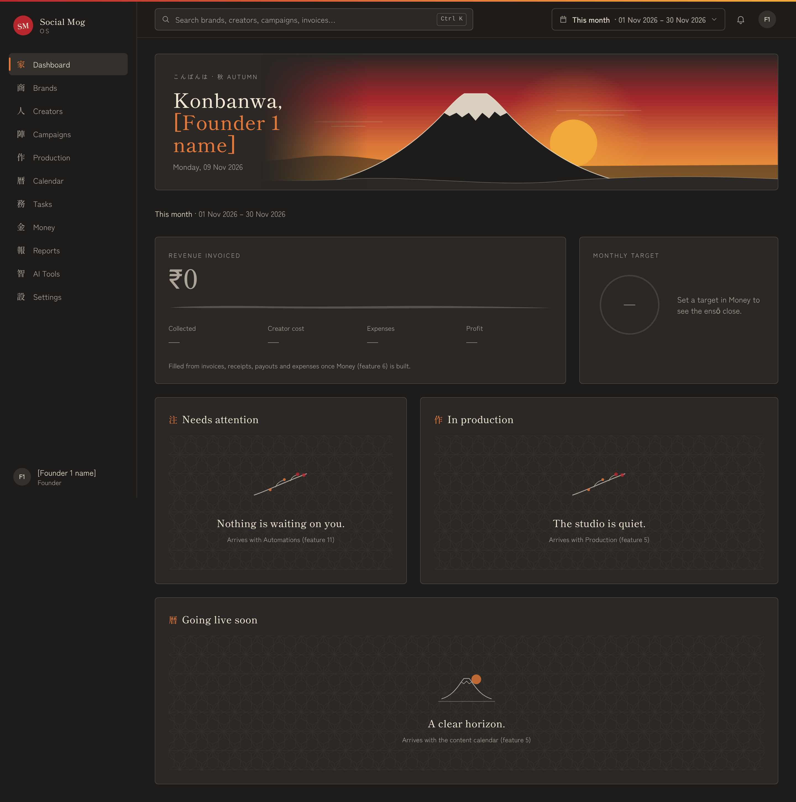

# Social Mog OS

Internal database and management site for **Social Mog**, an influencer production and campaign agency in India.
It keeps brands, creators, campaigns, production, tasks and money in one place, and calculates every total from the records.

**Status:** features 1 (login, roles, layout, activity log) and 2 (Brands) are built. The database schema for every later feature is already in place.



## Rules every feature follows

| Area | Rule |
|---|---|
| Stack | Supabase (Postgres, Auth, Storage, Edge Functions) + React/Vite/TypeScript/Tailwind |
| Tables | Real tables with foreign keys, not JSON blobs. Every table has `id uuid`, `created_at`, `updated_at` and `created_by`. Business records have `is_archived`/`archived_at` and are never hard-deleted. |
| Security | RLS is on for every table (the migration fails if one is missing). Roles are enforced in the database (see below), not only by hiding buttons. |
| Activity | Every table goes through `enable_standard_table()`, which adds the audit fields, the `activity_log` trigger (who, what, which record, old/new values) and RLS. An event trigger runs it automatically for any new table, and it refuses a table that is missing the standard columns. |
| Secrets | Only the public anon key is in the frontend. Service-role and AI keys live in Edge Function secrets. |
| Money | `numeric(14,2)`, INR. Shown as ₹1,00,000. Totals, balances, profit and outstanding amounts come from views and are never typed in. |
| Dates | DD MMM YYYY, Asia/Kolkata. The financial year runs 1 Apr – 31 Mar. Weeks run Monday–Sunday. |
| Lists | Search, filters, sort and CSV export on every list page |
| Records | Every record has a detail page with its linked records and activity history |

## Roles (enforced by RLS in `supabase/migrations/…_security_triggers.sql`)

| Role | Sees | Can't see |
|---|---|---|
| Founder | Everything | — |
| Manager | Everything, including money and salaries | Capital entries (opening balance, founder money in/out), team management, API keys, backups. Account balances are shown as totals only. |
| Team member | Their own tasks; campaigns they're on (`campaign_members`) and those deliverables; the brands and creators linked to them | Any money table, other people's tasks, Brands/Creators/Money/Reports pages |
| Freelancer | Deliverables, tasks and shoots assigned to them, plus the brand those belong to | Campaigns, money, everyone else's work |

Money that sits on work records lives in separate tables (`campaign_finances`, `campaign_creator_fees`, `deliverable_fees`), so team members and freelancers can see the work without seeing any amounts.

## Database (`supabase/migrations`)

```
team_members ─┬─ user_preferences       org_settings (1 row) · document_sequences
              ├─ campaign_members       import_batches ─ import_rows
              └─ (created_by on every table)    team_directory (view: names only)

brands ─┬─ brand_contacts
        ├─ brand_tags ─ tags ─ creator_tags ─┐
        ├─ retainers ─ retainer_scope_items  │
        └─ campaigns ─┬─ campaign_creators ──┤── creators ─┬─ creator_platforms ─ creator_metric_snapshots
                      │                      │             ├─ creator_rate_cards
                      │                      │             └─ creator_payment_details (founders only)
                      └─ deliverables ───────┘  (brand required; campaign/retainer optional)
                           ├─ scripts ─ ai_requests
                           ├─ deliverable_reviews · deliverable_metrics
                           └─ shoot_deliverables ─ shoots ─ shoot_crew (team / vendor / creator)
calendar_events            vendors (freelancers, studios, software)

money_accounts ─┬─ receipts ─ receipt_allocations ─ invoices ─ invoice_items
                ├─ expenses ─ expense_categories
                ├─ creator_payouts ─ creator_payout_items
                ├─ capital_entries (opening balance, founder in/out, loans)
                └─ account_transfers
targets

tasks · comments · files · notifications · automation_rules · reminders
ai_prompt_templates · ai_requests · api_clients · api_request_log · webhook_subscriptions
backups · saved_views · activity_log
```

**Calculated views:** `invoice_totals` (GST, paid, outstanding, overdue status), `creator_payout_totals` (gross, TDS, net), `money_ledger`, `campaign_financials` (profit, margin), `brand_financials`.
**Functions:** `account_balances()`, `period_summary(period)`, `period_bounds()`, `fy_start()`, `fy_label()`, `global_search(q)`, `schema_rule_violations()`.
The periods are `this_week`, `last_week`, `this_month`, `last_month`, `this_quarter`, `last_quarter`, `this_fy`, `last_fy` and `custom`.

## Brands (feature 2)

- **List:** table and card views, plus a pipeline board (`/brands?view=pipeline`) where you drag cards between Lead → Pitching → Active → Paused → Ended. The list filters by status, engagement type and owner, and exports to CSV.
- **Brand detail:** tabs for Overview, Contacts, Campaigns, Production, Invoices & Payments (founders and managers only), Files and Activity.
- **Calculated figures:** lifetime revenue, outstanding and active campaigns come from the `brand_overview` view. Revenue and outstanding read ₹0 until Money (feature 6) creates invoices.
- **Renewal warning:** a retainer renewing within 15 days, or already past its renewal date, gets a red lantern warning on the list, the cards, the pipeline and the detail page.
- **Files and logos:** stored in the private `records` bucket under `brands/<brand id>/`.

### Sample brands
- **Add them:** paste `supabase/samples/sample_brands.sql` into Supabase → SQL Editor and run it. This adds Chai Sutra (sample), an active brand with a retainer renewing in 10 days, and Neelam Naturals (sample), a pitching brand.
- **Remove them:** run `supabase/samples/remove_sample_brands.sql` the same way. It deletes only the two samples, their contacts, retainer, files and history. It refuses to run if you've attached real campaigns, tasks or invoices to a sample brand; archive that brand in the app instead. If you uploaded files to a sample brand, also delete its folder under `records/brands/` in Storage.

## Setting it up

1. **Founders:** put both founder names and emails in `supabase/migrations/20261109000800_seed_founders.sql`. The push stops with an error while the placeholders are still there.
2. **Push the schema:** `supabase link --project-ref <ref>`, then `supabase db push`.
3. **Auth settings** (Supabase dashboard → Authentication):
   - Turn off *Allow new users to sign up*.
   - Set *Site URL* to your app's address, and add `<site>/auth/callback` and `<site>/reset-password` as redirect URLs.
   - Enable the **Google** provider with your Google OAuth client ID and secret. In Google Cloud, the authorised redirect URI is `https://<ref>.supabase.co/auth/v1/callback`.
4. **Invite function:**
   - `supabase functions deploy invite-member`
   - `supabase secrets set APP_ORIGIN=https://<your-site>`

   The service-role key is provided to the function automatically; it never goes in the app.
5. **First logins:** invite both founder emails once from the dashboard (Authentication → Users → Invite user). Their logins link to the seeded rows. From then on, founders invite everyone from **Settings → Team**.
6. **Frontend:** `cp .env.example .env.local`, then add the project URL and anon key.

```bash
npm install
npm run dev                  # http://localhost:5173
npm test                     # ₹ format, IST dates, FY periods, CSV, role → page map, tab bar
npm run check:contrast       # WCAG AA check of every colour pair
npm run test:db              # migrations + role/RLS and brands checks on a local Postgres
```

Without Supabase settings, `npm run dev` shows a local-only design preview on the login page, so you can look around as each role. That preview is never included in a production build.

## Design system

The colour tokens are in `tailwind.config.js` and `src/styles/index.css`.
The original SVG artwork is in `src/components/art`: Fuji with a sky that follows IST time, the seasonal effects, ensō, hanko seals, brush dividers, the andon lantern, and the seigaiha, asanoha and torii patterns.
Screenshots are in `docs/preview`.
